# Using the Intervention Map

A short guide for the staff of the Provincial Agriculture Office and the MAOs. The Intervention Map shows every DA intervention in Marinduque, from machinery to irrigation and farm-to-market roads, on the province's 218 barangays.

**Address:** https://marinduque-intervention-system.netlify.app

The pictures come from the map's sample data. The beneficiary and signatory names in them are made up.

For setting up, deploying and backups, see [`OPERATIONS.md`](OPERATIONS.md).

**To try the map without an account,** or to show it to someone, use the demo site: https://marinduque-intervention-demo.netlify.app. Its sign-in screen has an account for each role, and its names are all made up. What you change there stays in your browser and never reaches the real map.

---

## Signing in

Accounts are by invitation. Your Admin sends you an email with a link: open it and choose a password of at least 8 characters. After that, sign in with your email and that password.

- **Forgot your password?** Ask your Admin for a new sign-in link.
- **Change your password:** open the menu under your name at the top right, then **Change password**.
- **Sign out:** the same menu, **Sign out**. On a shared computer, always sign out.

## Who can do what

| | Viewer | Encoder | Admin |
|---|---|---|---|
| See the map, Home, the Dashboard and every record | ✓ | ✓ | ✓ |
| Filter, save views, export, print reports | ✓ | ✓ | ✓ |
| Add, edit, move and delete records, update statuses, add photos | | ✓ | ✓ |
| QA queue, condition check, import files | | ✓ | ✓ |
| Restore deleted records | | | ✓ |
| Users, types and fields, lists, signature blocks, audit log | | | ✓ |

Your role shows under your name at the top right.

## Home

Home is where you land after signing in. It has the figures for the whole province and a card for each type of intervention. Encoders and Admins also see what's waiting for them: records that need QA, records waiting for verified coordinates, and units with no condition recorded yet. Each line opens the page to deal with it.

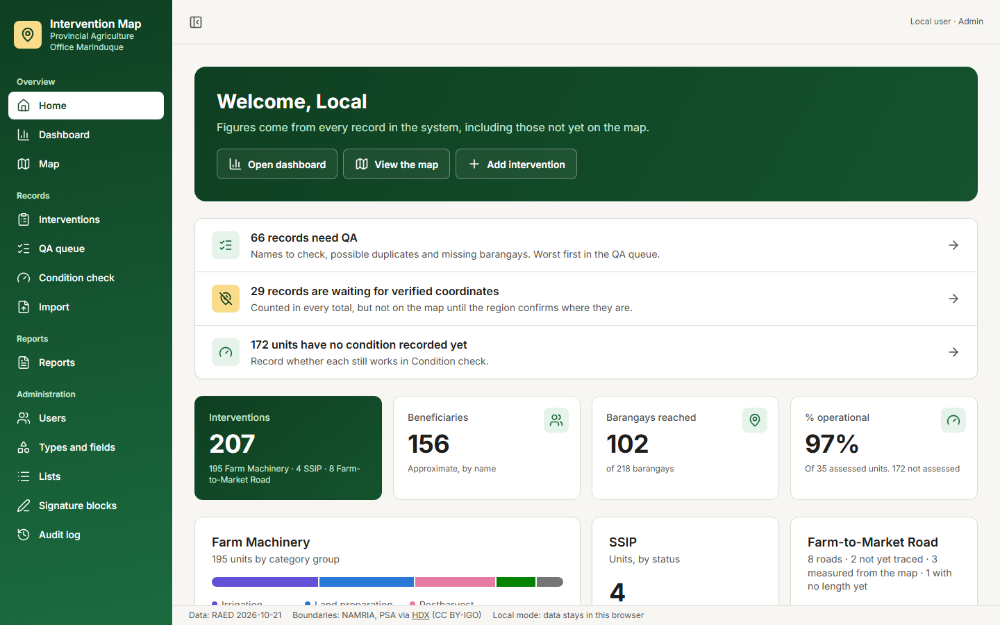

The menu on the left has every page. On a phone, it's behind the **☰** button.

## The map

The map opens on the whole province. Each barangay is shaded by how many interventions it has. Markers that sit close together are grouped into a green circle with a number: zoom in or click it to spread them out.

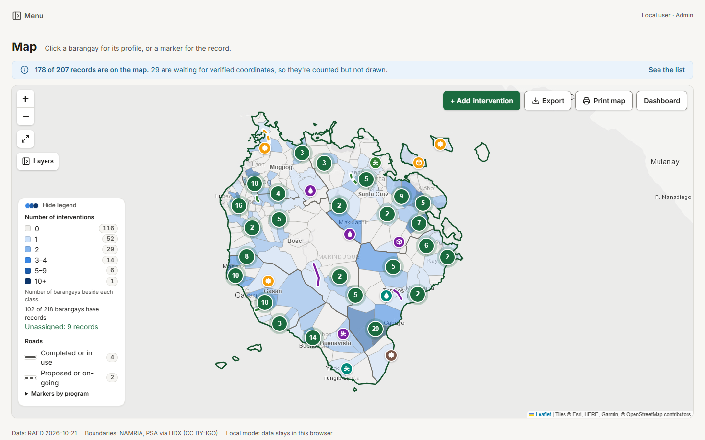

- **The blue line above the map** says how many records are on it. Records waiting for verified coordinates are counted everywhere but not drawn; **See the list** shows them.
- **The legend**, at the bottom left, explains the colors. Its top button folds it away.
- **The toolbar**, at the top right: **Add intervention**, **Export**, **Print map** and **Dashboard**.
- **Room for the map:** on a computer the menu, the layers card and the dashboard start put away. **Menu** at the top left, **Layers** under the zoom buttons and **Dashboard** in the toolbar bring each one out. The button under the zoom buttons makes the map full screen.

### Layers and filters

**Layers** opens the card for choosing what the map shows.

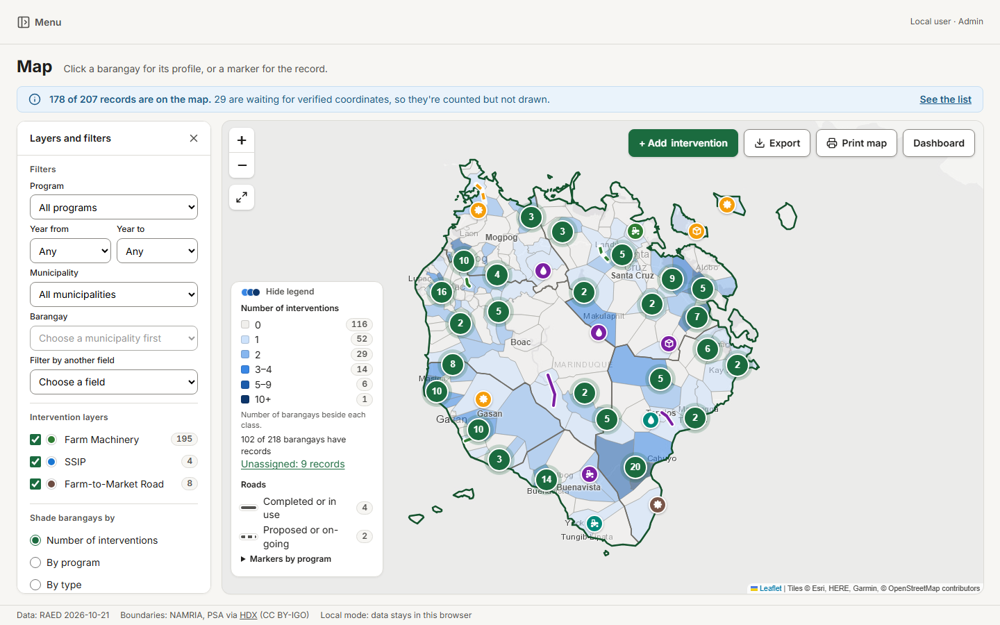

- **Filters** by program, year funded, municipality and barangay. **Filter by another field** offers every field, including each type's own.
- **Intervention layers** switch each type on and off.
- **Shade barangays by** the number of interventions, a program, a type, or the barangays with none yet.
- **Color markers by** any field.
- **Saved views** keep all of this, and the map's position, under a name. Share one with everyone if it's useful to others.

Filters are shared by the map, the Dashboard, the Interventions list and exports, so all of them always count the same records. **Clear filters** undoes them.

### A barangay's profile

Click a barangay, or choose it in **Go to barangay**, to open its profile on the right: its interventions, counts by type and program, and its baseline figures.

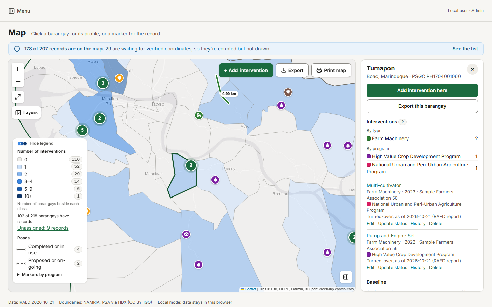

### A record

Click a marker, or a record in a profile, for its popup: what it is, its program, year, beneficiary and place, and its status with its date.

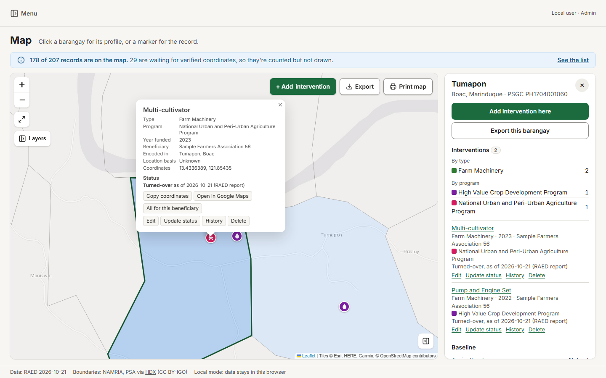

- **Copy coordinates** and **Open in Google Maps**, for going there.
- **All for this beneficiary** opens the beneficiary's report.
- Encoders and Admins also get **Edit**, **Update status**, **History** and **Delete**.

### On a phone

The **Map**, **Dashboard** and **List** tabs take turns. **Layers** slides the layers card up from the bottom, and the legend starts folded into a button.

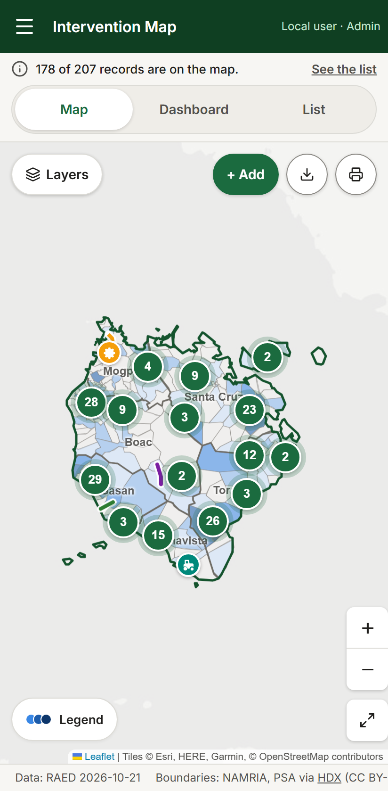

## Adding and changing records

*For Encoders and Admins.*

### Adding a record

1. Choose **Add intervention**, on the map's toolbar or on Home.
2. Click the map where it is. The form opens on the right, with the municipality and barangay filled in from where you clicked. Or type the coordinates in the form, paste them from Google Maps, use the GPS button, or take them from a geotagged photo.
3. Fill in the form. Starred fields are required. The fields depend on the type.
4. **Save.** The record is on everyone's map at once.

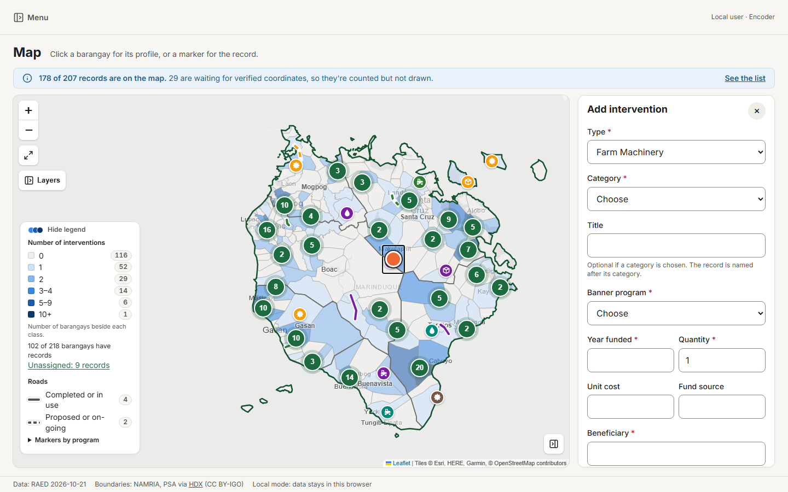

The form warns before saving if the point is outside Marinduque or outside the barangay you chose, or if a record like it is already there. You can still save, and the record is flagged for checking.

### Changing a record

- **Edit** opens the form with what's there. Only what you change is saved.
- **Move a marker:** drag it. Nothing moves until you choose **Confirm move**. **Cancel** puts it back. If it lands in another barangay, **Move and set barangay** changes its barangay too.
- **Update status** adds a new status with its date. The old ones stay in the record's status history.
- **Photos** go in the form's photo field.
- **Delete** takes a record off the map. An Admin can bring it back from **Deleted records**, at the bottom of the layers card.
- **Changing a barangay always asks for a reason**, which goes in the audit log.
- **Two people editing the same record:** if someone saved first, you're told, and what you typed is kept, so nothing is overwritten without anyone knowing.

### Farm-to-Market Roads

A road is a line, not a point. In its form, choose **Draw the line** and click along the road, in order, then **Done**. Drag a point to move it, or the small dot between two points to add a bend. Roads also come in with their lines from a Google Earth or GeoJSON file, through **Import**.

## The Interventions list and a record's page

**Interventions**, in the menu, lists every record the filters show. Sort by any column, search by name, ID, beneficiary or place, and **Export this table**. A record not on the map yet is marked.

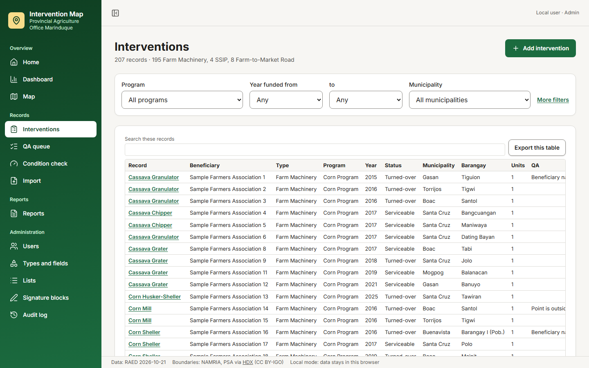

Click a record for its own page: its details, location, status history, QA flags, photos and, for Encoders and Admins, its change history. **Open on the map to edit** takes you to it on the map.

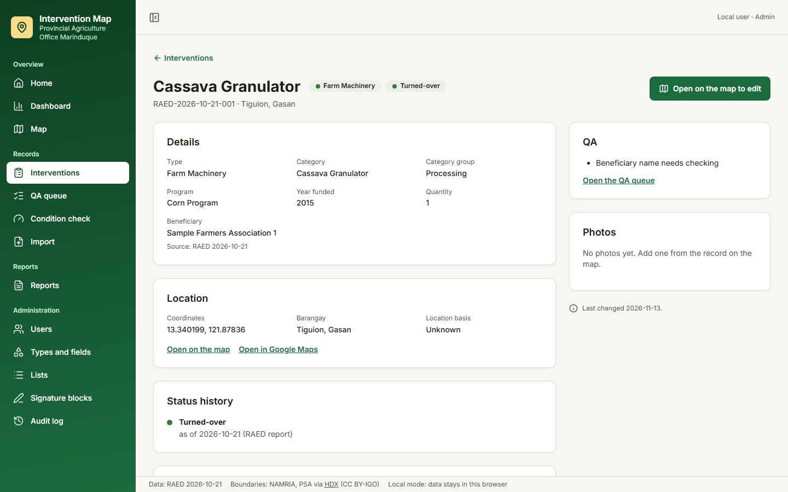

## The Dashboard

The same figures as Home, but following the filters, with charts by category group, municipality, program, year and category. **Show table** gives each chart's numbers, and **CSV** downloads them. At the bottom, **Awaiting coordinate verification** lists the records not on the map yet, by municipality, with a sheet to download for the region to check.

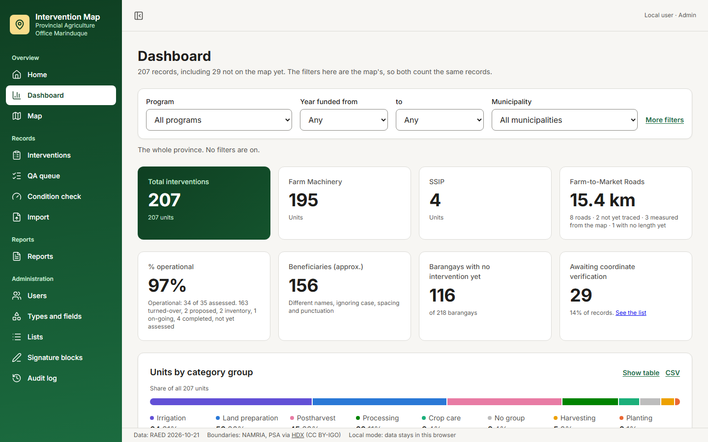

## The QA queue and the condition check

*For Encoders and Admins.*

**QA queue** lists every record with something to check, worst first: outside Marinduque, no coordinates, a barangay not on the list, then mismatches, names to check and shared points. Each offers what fits: **Fix on the map**, **Set barangay**, **Update status**, or **Dismiss** with a reason when the record is right as it is. Fixing the data clears a flag by itself.

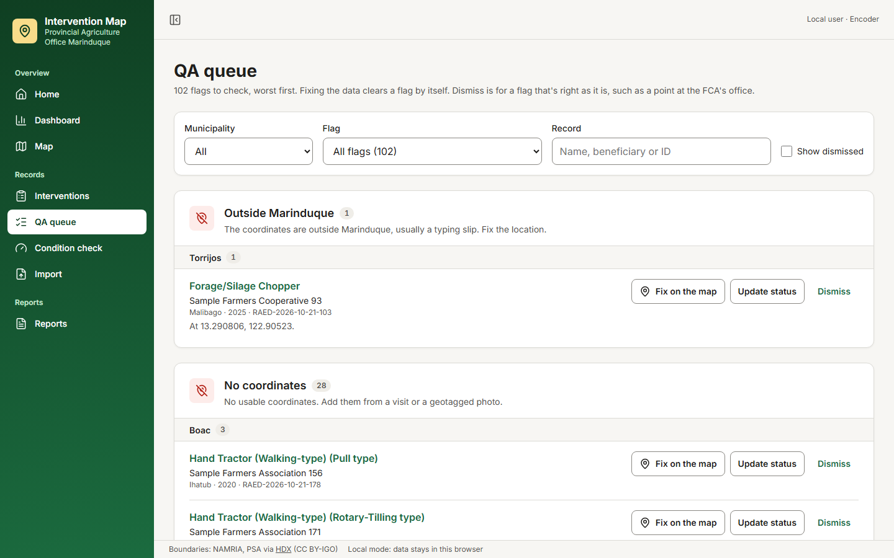

**Condition check** lists units delivered but not yet looked at. Record whether each still works, and it then counts in % operational.

## Importing a file

*For Encoders and Admins.*

**Import** brings in a CSV, Excel, Google Earth (KML or KMZ) or GeoJSON file of up to 2,000 rows, in four steps: the file, its columns, its values, and a check of every row. Nothing is saved until the last step. The columns you choose are remembered for the next file from the same source.

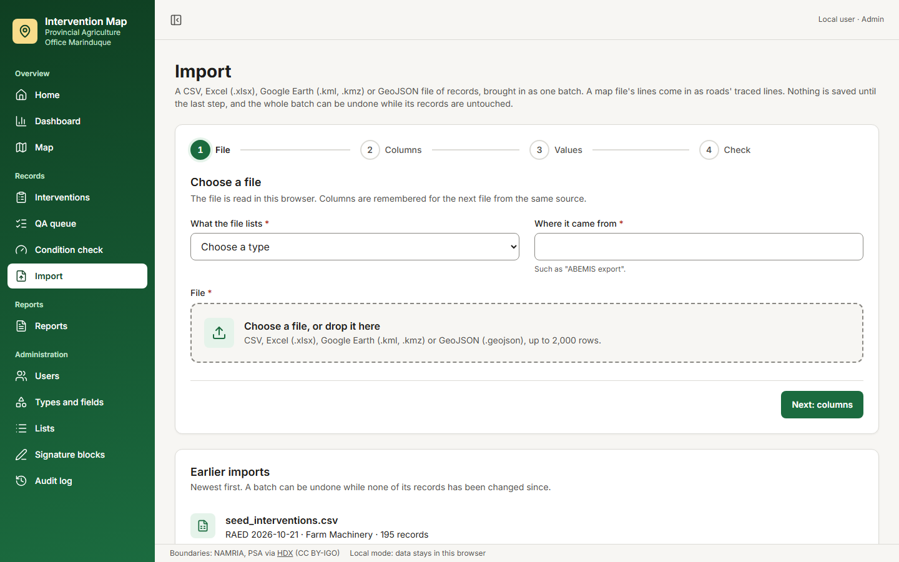

A whole import can be undone under **Earlier imports**, until someone changes one of its records.

## Exports and reports

**Export**, on the map, downloads what the filters show, for:

| Format | Use it for |
|---|---|
| KMZ | Google Earth, with the map's icons |
| KML | Google Earth and QGIS |
| CSV | Excel |
| GeoJSON | QGIS and web maps |
| Shapefile | QGIS and ArcGIS |

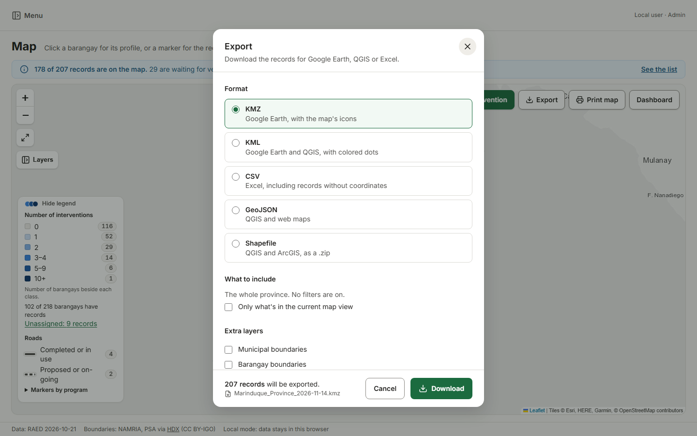

**Reports**, in the menu, makes PDFs ready to print and sign: a municipality on one page, everything one beneficiary has received, and the RAED-style inventory (also in Excel). **Print map**, on the map, prints it as it is on screen, with a legend, north arrow, scale bar and the signature blocks.

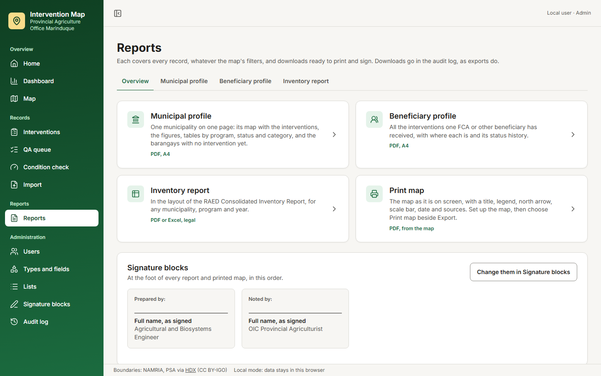

Exports and reports hold beneficiary names, so take care who you send them to. Every export and report is recorded in the audit log.

## Administration

*For Admins.*

| Page | What it's for |
|---|---|
| **Users** | Invite people, change their role, **Email a new link** or **Get a new link** to sign in, or deactivate an account |
| **Types and fields** | The kinds of intervention, each with its own form, icon, color and statuses, and the fields kept for every barangay |
| **Lists** | Programs, categories, statuses, beneficiary types and the other choices in the forms |
| **Signature blocks** | The names and positions at the foot of every report and printed map |
| **Audit log** | Who changed what and when, filtered by person, record, action and date |

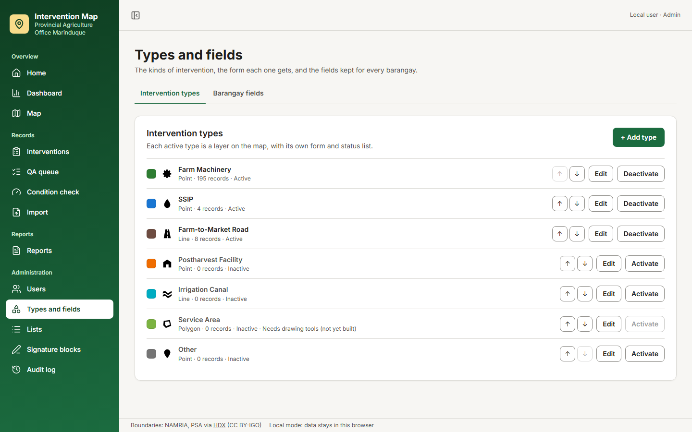

A new type, or a new field on a form, takes effect at once, with no change to the program.

## When something looks wrong

| You see | What it means |
|---|---|
| **Loading…** | The page is still getting the data. It usually takes a second or two |
| **This page could not load**, with **Try again** | Something stopped the data coming. Try again. **Details** has the exact message, for your Admin |
| **No connection** | Your device is offline. Try again once you're back online |
| **A newer version of the map is out** | The map was updated while your page was open. **Reload the page** |
| **Something went wrong on this page** | The page broke. Try again, or open another page from the menu. If it keeps happening, tell your Admin what you were doing |
| **No records match these filters** | The filters, or a layer switched off, leave nothing to show. **Show all records** clears them |
| **This page is for Admins** | Your role can't open it. Ask your Admin if you need to |
| **Live updates paused**, above the map | The connection for others' changes dropped. What you see may be a little out of date until it's back |

For anything else, ask your Admin.
